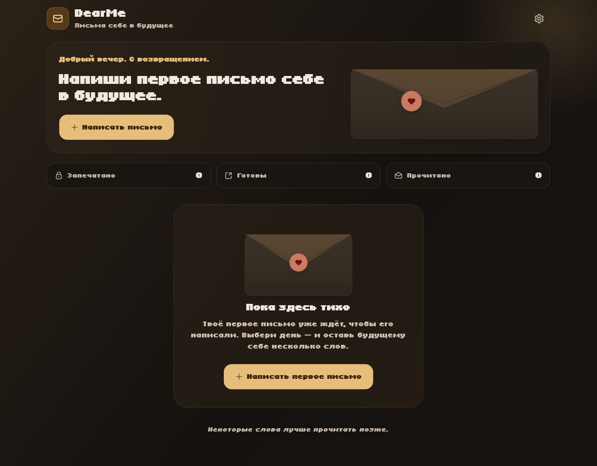
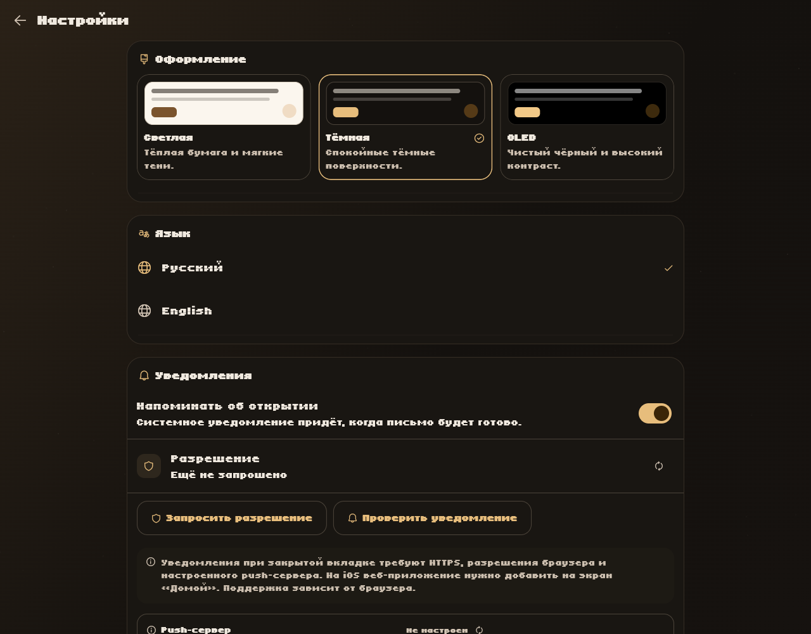
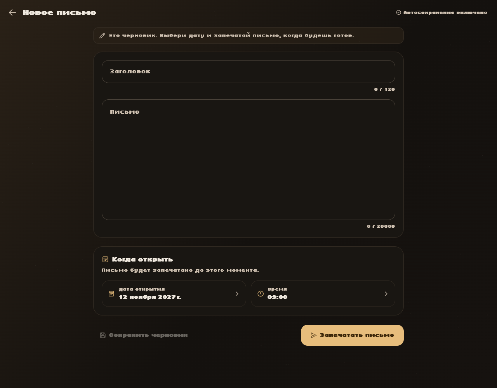

# DearMe

**Letters to your future self.**

DearMe is a complete cross-platform Flutter application for writing letters to
your future self. A letter stays sealed until its chosen date, then the user is
notified and can open it. The app supports Android, iOS, Web, Windows, macOS and
Linux from one codebase, with local-first storage and a small privacy-preserving
Web Push backend.



> **Naming:** the product name is **DearMe** in every user-visible place,
> window/executable/bundle name and installer. The Dart package stays `dearme`
> because Dart package identifiers must be lowercase; reverse-DNS IDs use
> `com.dearme.app`. Backup files are `DearMe-backup-*.json`, and older
> `"app": "dearme"` archives remain importable.

## Features

- **Letters with real states** — draft, sealed, ready to open, read. Sealed
  content is never rendered by the UI; a sealed letter can be rescheduled but
  not content-edited, which preserves the promise of the seal.
- **Letter editor** — title, long-form body, localized date/time pickers,
  character counters, validation, automatic draft saving, and a confirmation
  before sealing.
- **Opening animation** — a 3D wax-sealed envelope opens to reveal the letter.
  Read state is persisted.
- **Notifications on every platform** — native OS scheduling where the platform
  provides it, a real Service Worker + Web Push implementation on the web, and
  an honest Linux runtime fallback.
- **Three custom Material 3 themes** — Dark (default), Light and OLED true
  black, switchable without restart.
- **Russian and English** — full ARB localization with Russian as the default,
  independent of the system locale. Language changes apply immediately.
- **Local-first storage** — Sembast file database on native, IndexedDB on web.
  Settings use SharedPreferences. Letter text is never uploaded.
- **Settings that work** — theme, language, notification permission/status,
  test notification, system settings shortcut, statistics, JSON export/import,
  safe “delete all” with typed confirmation, licenses and app version.
- **Responsive, accessible UI** — phone, tablet, desktop and browser layouts;
  keyboard shortcuts (`Ctrl/Cmd+N`, `Ctrl/Cmd+,`), hover/ink feedback, 48dp touch
  targets, semantics labels and tooltips.
- **Tiny5Duo** used as the primary typeface. The font was checked for Latin,
  Cyrillic, digits and punctuation; emoji fall back to system emoji fonts.

| Settings | Editor |
| --- | --- |
|  |  |

## Verified build status

These commands were actually run in this workspace (Windows host, Flutter
3.47.9 / Dart 3.13.7):

| Command | Result |
| --- | --- |
| `flutter pub get` | Passed |
| `flutter gen-l10n` | Passed, no untranslated messages |
| `dart format .` | Passed |
| `flutter analyze` | **No issues found** |
| `flutter test` | **57 tests passed** |
| `flutter build web --release` | Passed |
| `flutter build apk --debug` | Passed (Android SDK 37, AGP 9.1.1, desugaring enabled) |
| `flutter build windows --debug` | Passed |
| `flutter build windows --release` + `iscc installer.iss` | Passed (Inno Setup 6.7.3) |
| Installer silent install → file verification → silent uninstall | Passed |
| Backend `npm install`, `node --check server.js` | Passed |
| Backend `/api/health`, `/api/config`, auth and CORS smoke checks | Passed |
| Headless Chrome integration: grant permission → register push worker → create `PushSubscription` → POST subscription → PUT schedule | Passed |
| Server-side push send to the real FCM endpoint | Accepted (`delivered_at` recorded, no error) |

**Not built here:** iOS, macOS and Linux. Their code and configuration are
included, but this machine has no Xcode and no Linux toolchain, so those builds
must be verified on the respective hosts. Platform-specific limitations are
listed below instead of being claimed as tested.

## Quick start

Requirements: Flutter 3.47+ with Dart 3.13+.

```bash
flutter pub get
flutter gen-l10n
flutter run -d windows      # or android, chrome, macos, linux, ios
```

The app works offline without any backend for everything except background Web
Push. On Web, add the backend address at build time:

```bash
flutter build web --release \
  --dart-define=DEARME_PUSH_API=https://push.example.com
```

Serve `build/web` over HTTPS (or `http://localhost` during development). The
Service Worker, VAPID key and server are required for notifications while the
tab is closed. See [Web Push setup](#web-push-setup).

## Project structure

```text
lib/
  main.dart                     bootstrap, DB fallback, DI container
  app/
    app.dart                    MaterialApp.router, themes, shortcuts, lifecycle
    app_keys.dart               root ScaffoldMessenger key
    router.dart                 GoRouter + custom transitions
    providers.dart              Riverpod graph, controllers, statistics
    startup_coordinator.dart    notification init, launch deep link, resync
    snackbar.dart               app-wide confirmations
    theme/app_theme.dart        Material 3 themes + DearMePalette extension
    localization/               date formatting and l10n context extension
  core/
    database/                   Sembast native/IndexedDB with migrations
    models/                     Letter, status, settings, theme/locale options
    services/                   NotificationService abstraction, native
                                implementation, Web Push client, time zone
    utils/                      countdown, platform helpers
  features/
    letters/
      application/              LetterService (persistence + scheduling)
      data/                     letter repository, JSON transfer
      presentation/             home, editor, detail, widgets
    settings/
      data/                     SharedPreferences settings repository
      presentation/             settings screen
  l10n/                         ARB files + generated localizations
  shared/widgets/               background and responsive width
backend/                        Node.js Web Push scheduler
web/                            manifest, splash, push service worker, icons
installer.iss                   Inno Setup script for the Windows installer
test/                           57 unit and widget tests
docs/screenshots/               real screenshots of the built web app
```

### Windows installer

The repository includes `installer.iss` for Inno Setup 6.3+.

```bash
flutter build windows --release
iscc installer.iss
```

If `iscc` is not on `PATH`, open `installer.iss` in the Inno Setup Compiler or
run `%LOCALAPPDATA%\Programs\Inno Setup 6\ISCC.exe installer.iss`.

The result is `build\windows\installer\DearMe-1.0.0-windows-x64-setup.exe`.
It installs per-user by default (`%LOCALAPPDATA%\Programs\DearMe`), creates
Start-menu and optional desktop shortcuts, copies the complete Flutter release
bundle, and uninstalls cleanly. The version and output name are defined at the
top of `installer.iss`; keep `MyAppVersion` in sync with `pubspec.yaml`.

This is a regular desktop installer, not MSIX. It associates the shortcuts with
`DearMe.App` and the same toast activator CLSID used by
`WindowsInitializationSettings`, so native notifications have the right identity,
but the “no package identity” caveat for already-shown notifications still
applies. For full Windows package identity, package the release as MSIX.

The installer was compiled and tested (silent install into a temporary directory,
file verification, then silent uninstall).

## What was implemented where

### Storage and reliability

- Sembast database file on native platforms and IndexedDB on web, through a
  conditional-import factory. No `dart:io` in web code.
- Letters are keyed by UUID and store UTC instants. A per-record
  `schemaVersion` plus a database `meta` record provide a migration path.
  Individual damaged records are skipped rather than making the archive
  unreadable.
- Draft autosave is debounced; leaving the editor flushes the draft. If storage
  cannot be opened at startup, the app falls back to an in-memory database and
  shows an explicit warning instead of silently pretending data is safe.
- All writes are awaited and failures are surfaced. Notification failures never
  roll back a saved letter; the UI reports that the reminder could not be
  scheduled.

### Notifications

`NotificationService` is a platform-agnostic contract. The implementation is
selected at startup:

- **Android** — `flutter_local_notifications` with a high-importance channel,
  `POST_NOTIFICATIONS` request, inexact alarms (no restricted exact-alarm
  permission), boot rescheduling receivers, notification tap payloads, and
  cancellation on delete/reschedule.
- **iOS / macOS** — `flutter_local_notifications` / UserNotifications, explicit
  permission requests, scheduled local notifications and tap handling.
- **Windows** — native scheduled toast notifications through the plugin.
- **Linux** — there is no system scheduler in the desktop notification spec.
  DearMe keeps timers while the app is running and shows **real system
  notifications** when they fire. This limitation is shown in Settings.
- **Web** — a real Web Push architecture:
  - `PushManager.subscribe` with a VAPID public key fetched from the server;
  - a dedicated Service Worker registered on `/push-scope/`, intentionally
    separate from Flutter’s own generated worker so the two cannot take over
    each other’s scope;
  - server-side scheduling and delivery (Node.js + `web-push`);
  - click URLs that open the exact letter (`?letter=<uuid>`);
  - permission checks before every sync and honest “not configured” states.

No Firebase/FCM configuration is used. That avoids conflicting messaging
service workers and avoids shipping any secret in the client.

### Notifications lifecycle rules

On save, delete, reschedule, open, app start, locale change and app resume, the
complete future schedule is rebuilt from the database:

- drafts, read letters and past openings are never scheduled;
- deleted letters disappear from the schedule;
- date changes replace the previous schedule;
- permission loss or disabling notifications cancels the schedule;
- the schedule uses localized copy generated from the current language;
- iOS is limited to the next 60 pending notifications (iOS keeps 64).

Native notifications use the absolute UTC opening instant converted to the
device time zone at scheduling time. Time-zone changes therefore do not move the
instant; the app reschedules on resume/startup to refresh the OS calendar
trigger.

### Web Push backend

`backend/` is a small Node.js 24+ service using Express 5, `web-push` and the
built-in SQLite driver:

- stores only subscription data, a hashed device token, letter UUIDs and
  delivery times;
- sends localized notifications from a server-side message table;
- replaces the schedule atomically on every client sync;
- handles `404`/`410` subscription expiry, retries, and terminal failures;
- validates endpoints, origins and payload sizes;
- rate limits requests and accepts only configured browser origins.

See [backend/README.md](backend/README.md) for deployment, API contract and
security notes.

### Themes and design

- Material 3 with a central `ThemeData` factory and a `DearMePalette` theme
  extension for decorative colours. No widget hardcodes theme colors.
- **Dark** is the default. **Light** uses a warm-paper palette. **OLED** uses
  `#000000` surfaces, 1px borders instead of elevated gray fills, and high
  contrast.
- Custom envelope illustration, wax seal, soft grain background, sectioned home
  screen, responsive card grid, animated theme/locale switches, fade/slide route
  transitions and an envelope opening animation.
- Fluent UI icons (`fluent_icons_kit`) are used throughout. Material’s internal
  date/time picker icons remain Material because they are part of the standard
  components.

### Font

The real font files in `assets/fonts/Tiny5Duo/` are registered as family
`Tiny5Duo`. The app registers Regular, Italic, Medium, SemiBold, Bold and
BoldItalic; unused weights are not bundled. A fontTools inspection confirmed
full Russian/Cyrillic + Latin + digits + punctuation coverage. The emoji in the
notification copy is not present in the font, so the theme supplies
`Segoe UI Emoji`, `Apple Color Emoji`, `Noto Color Emoji` fallbacks. Long body
text uses generous line height and a scalable, scrollable reading surface.

### Localization

All user-facing strings live in `lib/l10n/app_ru.arb` and `app_en.arb`:
screens, dialogs, buttons, validation, empty states, dates via `intl`, errors,
settings, notification copy and accessibility labels. Russian is the default
regardless of system language. The selected locale is persisted and applied
without restart.

## Web Push setup

1. Deploy the backend with HTTPS:

   ```bash
   cd backend
   npm install
   npm run generate-vapid      # once; copy keys into .env
   cp .env.example .env        # fill VAPID_* and ALLOWED_ORIGINS
   npm start                   # or docker compose up -d --build
   ```

2. Build the Flutter web app pointing at that server:

   ```bash
   flutter build web --release \
     --dart-define=DEARME_PUSH_API=https://push.example.com
   ```

3. Serve the build over HTTPS. Static files must be served with the correct JS
   MIME type so the service worker can register.

4. In DearMe → Settings → Notifications, grant permission. Create a sealed
   letter and keep the app open for one sync; the backend now has the schedule.
   Close the tab: the backend’s scheduler delivers the notification at the
   opening instant and the service worker opens the letter when clicked.

Requirements and caveats:

- Web Push requires a secure context (`https://` or `localhost`).
- Permission must be requested from a user gesture; the app only asks after the
  user presses the switch/button.
- Chrome/Edge, Firefox and Safari 16.4+ have differing support. On iOS/iPadOS,
  the web app must be added to the Home Screen; Safari may still throttle or
  suspend background delivery.
- The backend process must stay running; it does the scheduling. The scheduler
  checks every 30 seconds by default, so Web Push delivery can be up to roughly
  30 seconds late. Use a process manager or the included Docker setup.
- If a browser rotates its push subscription while the app is closed, the app
  re-subscribes and re-uploads the schedule on its next launch. Until then the
  old endpoint may be gone. This is a browser/platform behavior, not a promise
  of universal delivery.
- TTL defaults to 24 hours; a device offline longer than TTL may miss a push.
- The server may rarely send a duplicate if it crashes between a successful
  push and marking the row delivered (at-least-once trade-off).

A localhost integration run in headless Chrome was used to verify the complete
client path up to the real FCM push service: the app registered the isolated
push worker, created a subscription, uploaded it, sent the schedule, and the
backend delivered a push (the FCM request was accepted and `delivered_at` was
recorded). Headless Chrome cannot confirm whether the operating system visually
displayed the notification, so visual delivery on each desktop/mobile browser
still needs a release-device check. The backend database was inspected after the
run to confirm that it contained the letter UUID and delivery time but **no
letter title or body**.

## Platform limitations (honest list)

| Platform | Implementation | Known limitations |
| --- | --- | --- |
| Android | Native scheduled notifications, boot receiver, channels | Exact timing is not promised; Doze/OEM battery managers can delay delivery. Also alarms are inexact by design. Users may need to disable battery optimization. Some OEMs restrict background work. |
| iOS | Native local notifications | iOS keeps at most 64 pending notifications; DearMe schedules the next 60. Delivery timing is controlled by iOS. Permission may be revoked later. |
| macOS | UserNotifications via plugin | Permission and Focus modes are controlled by macOS. App sandbox file access entitlements are included for import/export. |
| Windows | Scheduled toast notifications | Without an MSIX/package identity, an already-shown notification cannot be removed from Action Center and active notifications cannot be enumerated. Cancelling a *scheduled* toast still works. Notification text/icon behavior depends on Windows. |
| Linux | Real desktop notifications via the notification daemon; timers while app runs | The desktop spec has no scheduler, so delivery while the app is closed is not possible. This is disclosed in Settings. |
| Web | Service Worker + Push API + VAPID backend | No guarantee across all browsers/devices; iOS requires Home Screen install; server must be running; HTTPS; TTL/offline constraints. Immediate browser notifications require permission. |

## Required external configuration

DearMe does not include secret keys. A developer deploying it must provide:

| Item | Where | Notes |
| --- | --- | --- |
| VAPID public key | `backend/.env` | Generated with `npm run generate-vapid`; delivered to the browser via `/api/config` |
| VAPID private key | `backend/.env` | Secret; never commit or put in Flutter/Web assets |
| VAPID subject | `backend/.env` | `mailto:` or `https:` contact |
| `ALLOWED_ORIGINS` | `backend/.env` | Exact production origin(s), e.g. `https://dearme.example.com` |
| Push API URL | Flutter build | `--dart-define=DEARME_PUSH_API=https://push.example.com` |
| HTTPS domain / TLS | Deployment | Required for Web Push and service workers |
| Android release keystore + applicationId | `android/` | Debug builds use the debug key and `com.dearme.app`; provide your own release key and final application ID |
| Apple signing team + bundle IDs | `ios/`, `macos/` | Set your Apple team and a bundle ID you control (currently `com.dearme.app`); no push certificate is needed because iOS uses local notifications |
| Windows code-signing/MSIX setup | `windows/` | Required for package identity and some notification operations |

No Firebase project, `google-services.json`, `GoogleService-Info.plist`, APNs
key or Google Maps key is required.

## Data format and migration

Export produces a UTF-8 JSON file:

```json
{
  "app": "DearMe",
  "formatVersion": 1,
  "exportedAt": "2026-11-12T12:00:00.000Z",
  "letters": [
    {
      "schemaVersion": 1,
      "id": "uuid",
      "title": "…",
      "body": "…",
      "createdAt": "…Z",
      "updatedAt": "…Z",
      "openAt": "…Z",
      "openedAt": null,
      "notificationId": 123456,
      "isDraft": false
    }
  ]
}
```

Import validates the app/version, skips damaged records, and merges by id using
`updatedAt` (newest wins). The export contains plain-text letters chosen by the
user; protect the file accordingly.

## Testing

```bash
flutter analyze
flutter test
```

Coverage includes:

- letter state transitions and serialization;
- repository save/read/watch/delete/import and damaged-record tolerance;
- drafts, sealing, future-only scheduling, deletion and rescheduling;
- opening blocked before the date and persisted after opening;
- permission denial, disabled notifications, notification/storage failures;
- theme/locale persistence and controller rollback on write failure;
- RU/EN localization and plural forms;
- notification payload parsing;
- JSON export/import and malformed archives;
- widget flows for home, settings, language/theme switching, editor validation,
  sealing without content leakage, opening after the date, and deletion;
- narrow-screen, 160% text-scale layout checks for home, editor, settings and
  the sealed-letter screen.

The notification tests use a fake `NotificationService` through Riverpod
injection, so they never touch real system notification APIs.

## Privacy

- Letters stay in the local Sembast database/IndexedDB. There is no cloud sync.
- The Web Push backend receives **only** the push subscription, a hashed device
  token, a letter UUID, the delivery instant, locale and technical click URL.
  It never receives a title or body.
- Server tokens are random 32-byte values stored as SHA-256 hashes; VAPID
  private keys remain server-side.
- The app does not request notification permission automatically on launch.
- Analytics, tracking and third-party SDKs are not included.

## Troubleshooting

- **No notifications on web:** check HTTPS, browser permission, that
  `DEARME_PUSH_API` was set at build time, that `ALLOWED_ORIGINS` exactly matches
  the app origin, and that the backend is running. On iOS add the app to the
  Home Screen.
- **Notifications on Android are late:** Android may delay inexact alarms.
  Check battery optimization and OEM background restrictions.
- **Linux notifications while closed:** not supported by the platform; the app
  must be running. Settings states this.
- **No sound/notification on iOS/macOS:** check Focus/Do Not Disturb and system
  notification settings.
- **Font shows boxes:** Tiny5Duo covers Latin/Cyrillic. Rare scripts and emoji
  use system fallbacks; install a system emoji font if none is present.
- **Database warning banner:** the app could not open the persistent database
  and is using memory storage; restart after fixing storage permissions.
