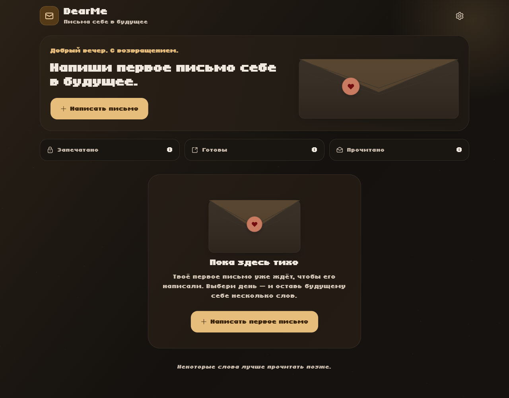
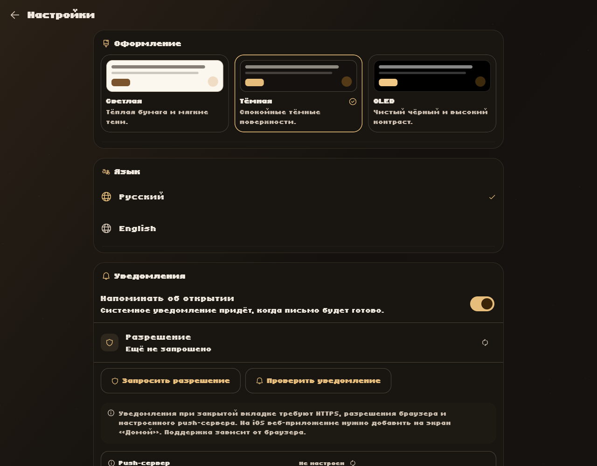

<p align="center">
  
</p>

<h1 align="center">DearMe</h1>

<p align="center">
  <strong>Letters to your future self.</strong>
</p>

<p align="center">
  English | <a href="README_RU.md">Русский</a>
</p>

---

DearMe is a cross-platform application for writing and sealing letters to be delivered to your future self. Each letter remains sealed until the chosen opening date, keeping your thoughts, goals, and reflections intact until the right moment arrives.

<p align="center">
  
  &nbsp;&nbsp;&nbsp;&nbsp;
  
</p>
<p align="center">
  <em>Home screen &nbsp;&nbsp;&nbsp;&nbsp;&nbsp;&nbsp;&nbsp;&nbsp;&nbsp;&nbsp;&nbsp;&nbsp;&nbsp;&nbsp;&nbsp;&nbsp;&nbsp;&nbsp;&nbsp;&nbsp;&nbsp;&nbsp;&nbsp;&nbsp;&nbsp;&nbsp;&nbsp;&nbsp;&nbsp;&nbsp;&nbsp;&nbsp;&nbsp;&nbsp;&nbsp;&nbsp; Settings screen</em>
</p>

## Features

- **Letters to your future self**: Write and seal letters that remain locked until a specified date and time.
- **Scheduled notifications**: Local reminders alert you the moment a sealed letter is ready to open.
- **Light, Dark, and OLED themes**: Three custom Material 3 themes designed for comfort in any lighting.
- **Typography options**: Select between Google Sans (default), Shantell Sans, and Tiny5Duo font styles.
- **Russian and English languages**: Complete interface localization with seamless switching.
- **Cross-platform support**: Unified experience across mobile, desktop, and web environments.
- **Export and import**: Backup and restore your letters using portable JSON archives.

## Supported Platforms

DearMe supports the following platforms from a single Flutter codebase:

- **Android** (Android 8.0+)
- **Windows** (Windows 10, Windows 11 x64)
- **Web** (Modern standards-compliant browsers)
- **iOS**, **macOS**, **Linux**

## Installation & Build

### Prerequisites

- [Flutter SDK](https://flutter.dev/docs/get-started/install) (3.47 or higher)
- [Inno Setup 6](https://jrsoftware.org/isdl.php) (optional, for compiling the Windows installer)

### Quick Start

1. Clone the repository and navigate to the project directory:

   ```bash
   git clone https://github.com/your-username/dearme.git
   cd dearme
   ```

2. Install dependencies and generate localization code:

   ```bash
   flutter pub get
   flutter gen-l10n
   ```

3. Run the application on your connected device:

   ```bash
   flutter run
   ```

### Building Release Artifacts

- **Windows Desktop:**

  ```bash
  flutter build windows --release
  ```

  To package the Windows standalone installer (`DearMe-Setup.exe` in `dist/`):

  ```bash
  iscc installer.iss
  ```

- **Android (APK):**

  ```bash
  flutter build apk --release
  ```

- **Web:**

  ```bash
  flutter build web --release
  ```

### Running Tests and Analyzer

```bash
flutter analyze
flutter test
```

## License

Font assets bundled in this project are distributed under the [SIL Open Font License 1.1](assets/fonts/OFL.txt).
