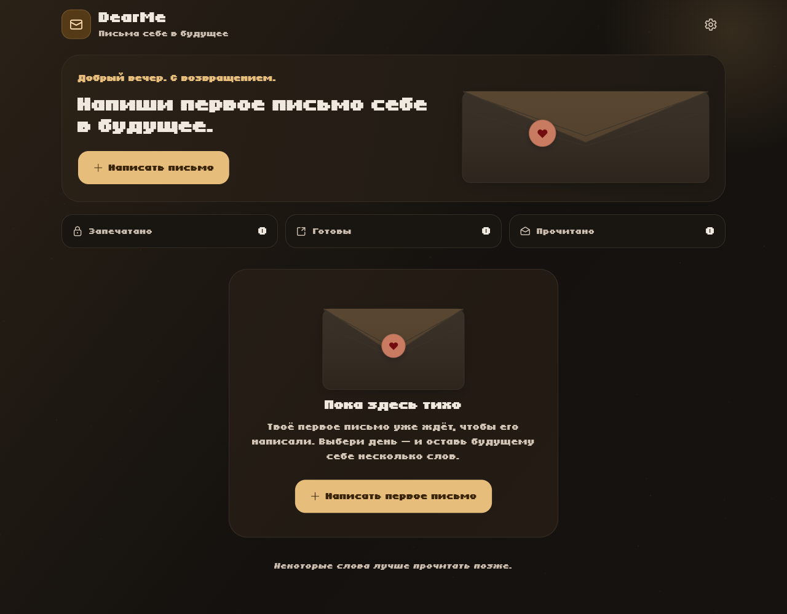
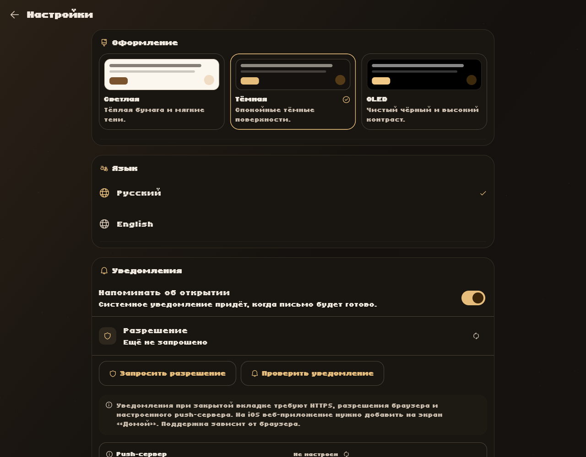

<p align="center">
  
</p>

<h1 align="center">DearMe</h1>

<p align="center">
  <strong>Письма самому себе в будущее.</strong>
</p>

<p align="center">
  <a href="README.md">English</a> | Русский
</p>

---

DearMe — это кроссплатформенное приложение для написания и запечатывания писем в будущее. Каждое письмо остаётся запечатанным до выбранной даты открытия, надёжно сохраняя ваши мысли, цели и воспоминания до нужного момента.

<p align="center">
  
  &nbsp;&nbsp;&nbsp;&nbsp;
  
</p>
<p align="center">
  <em>Главный экран &nbsp;&nbsp;&nbsp;&nbsp;&nbsp;&nbsp;&nbsp;&nbsp;&nbsp;&nbsp;&nbsp;&nbsp;&nbsp;&nbsp;&nbsp;&nbsp;&nbsp;&nbsp;&nbsp;&nbsp;&nbsp;&nbsp;&nbsp;&nbsp;&nbsp;&nbsp;&nbsp;&nbsp;&nbsp;&nbsp;&nbsp;&nbsp;&nbsp;&nbsp;&nbsp;&nbsp; Настройки</em>
</p>

## Основные возможности

- **Письма самому себе в будущее**: Создавайте и запечатывайте письма, доступ к тексту которых закрыт до наступления установленного срока.
- **Запланированные уведомления**: Локальные оповещения напомнят вам в тот момент, когда письмо будет готово к прочтению.
- **Светлая, тёмная и OLED-темы**: Три персонализированные темы Material 3 для комфортной работы при любом освещении.
- **Выбор шрифтов**: Переключение между шрифтами Google Sans (по умолчанию), Shantell Sans и Tiny5Duo.
- **Русский и английский языки**: Полноценная локализация интерфейса с мгновенным переключением.
- **Кроссплатформенность**: Единый интерфейс и функционал на мобильных устройствах, настольных ПК и в браузере.
- **Экспорт и импорт писем**: Резервное копирование и восстановление писем через переносимые JSON-архивы.

## Поддерживаемые платформы

DearMe работает на следующих платформах на базе единой кодовой базы Flutter:

- **Android** (Android 8.0+)
- **Windows** (Windows 10, Windows 11 x64)
- **Web** (Современные браузеры с поддержкой актуальных веб-стандартов)
- **iOS**, **macOS**, **Linux**

## Инструкции по установке и сборке

### Требования

- [Flutter SDK](https://flutter.dev/docs/get-started/install) (версии 3.47 или выше)
- [Inno Setup 6](https://jrsoftware.org/isdl.php) (опционально, для сборки Windows-установщика)

### Быстрый старт

1. Клонируйте репозиторий и перейдите в папку проекта:

   ```bash
   git clone https://github.com/your-username/dearme.git
   cd dearme
   ```

2. Загрузите зависимости и сгенерируйте код локализации:

   ```bash
   flutter pub get
   flutter gen-l10n
   ```

3. Запустите приложение на подключённом устройстве:

   ```bash
   flutter run
   ```

### Сборка релизных версий

- **Windows Desktop:**

  ```bash
  flutter build windows --release
  ```

  Для создания установщика Windows (`DearMe-Setup.exe` в директории `dist/`):

  ```bash
  iscc installer.iss
  ```

- **Android (APK):**

  ```bash
  flutter build apk --release
  ```

- **Web:**

  ```bash
  flutter build web --release
  ```

### Запуск анализатора и тестов

```bash
flutter analyze
flutter test
```

## Лицензия

Шрифты, включённые в проект, распространяются под лицензией [SIL Open Font License 1.1](assets/fonts/OFL.txt).
